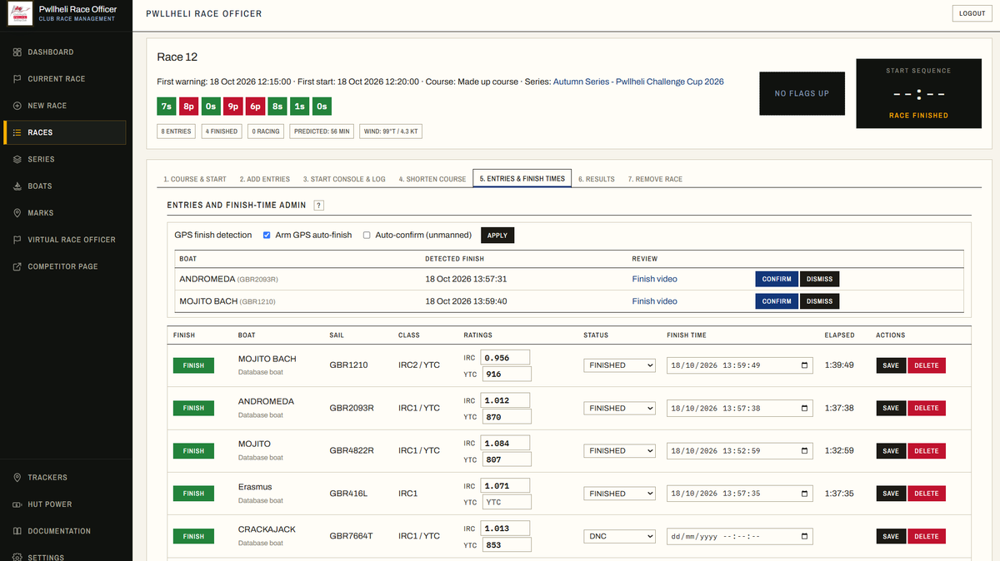
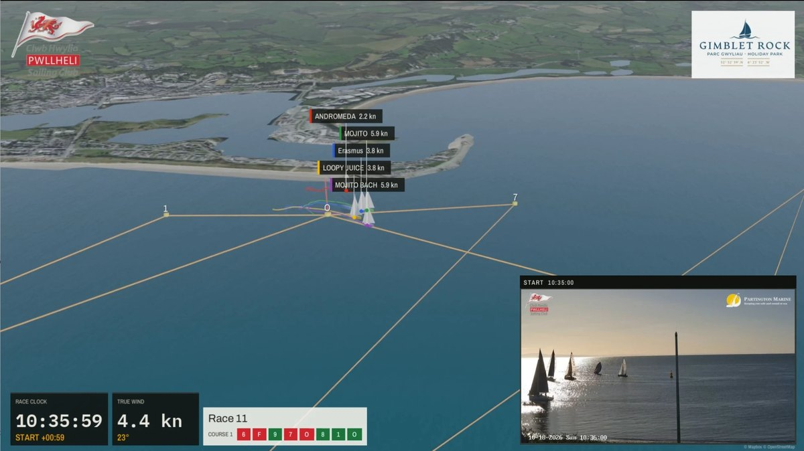
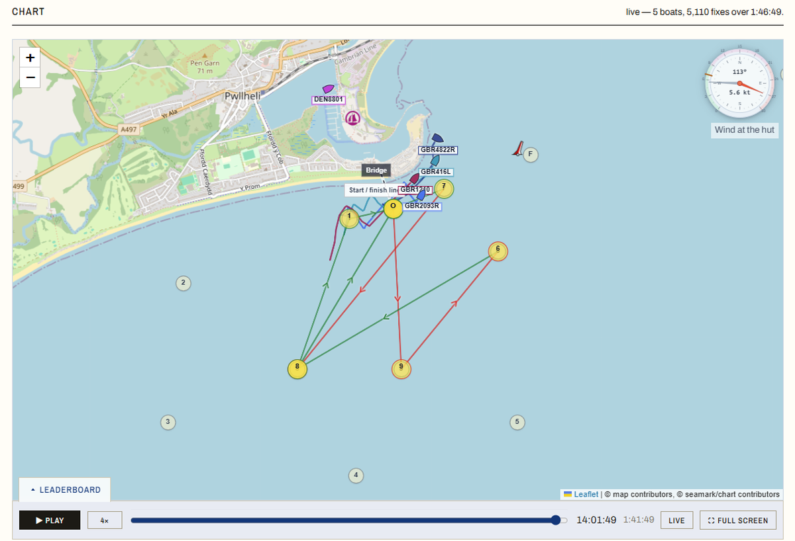
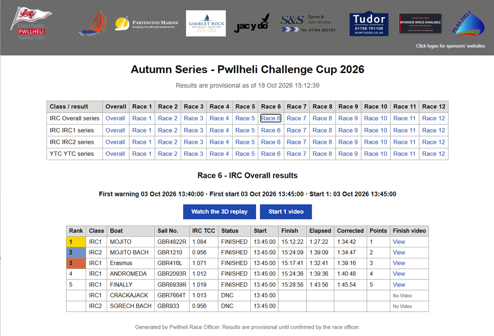

# Pwllheli Race Officer v1.019

A human-supervised race-management app for Pwllheli Sailing Club racing. It helps the race officer prepare races, recommend or build courses, manage entries, run configurable RRS 26-style start sequences, log horn events, record finish times, calculate IRC/YTC race results, score race series, publish competitor information pages and keep video evidence of starts and finishes.

Race-office support software. It does not decide anything: official race decisions remain with the race officer and race committee, and results are provisional until they confirm them.


<table>
  <tr>
    <td align="center"><a href="docs/images/readme_race_sheet.png"></a><br>The race sheet: finish times, and GPS finishes to confirm</td>
    <td align="center"><a href="docs/images/readme_3d_replay.jpg"></a><br>A 3D replay, with the start camera's video</td>
  </tr>
  <tr>
    <td align="center"><a href="docs/images/readme_race_chart.png"></a><br>The public race page: the boats' tracks on the chart</td>
    <td align="center"><a href="docs/images/readme_series_results.png"></a><br>Published series results</td>
  </tr>
</table>

## Guides

- [Race Officer's Guide](docs/Pwllheli_Race_Officer_Series_Guide.pdf) — running a series of races and publishing results.
- [Competitor's Guide](docs/Pwllheli_Competitor_Guide.pdf) — what to expect on the public race-day pages.
- [Reference Manual](docs/Pwllheli_Race_Officer_Reference_Manual.pdf) — installation, hardware integration and every admin function.
- [Relay & Front Door Guide](docs/Pwllheli_Relay_Guide.pdf) — the one machine the club is reached through: front door, live camera and GPS tracking.

Setup, hardware, video, tracking, the public pages and the rest are listed under [Documentation](#documentation) below.


## Recent releases

### v1.019 update

- **The club's name and logos are settings** (Settings → Club name and branding), for running the app at
  another club; Pwllheli's are the defaults. See `docs/CLUB_CUSTOMISATION.md`.
- **3D films**: the club's name on the cards, IRC and YTC on the closing card whatever the rating rule, and
  land out to the horizon.
- **Cloud storage (Cloudflare R2)** has its own Settings section; a club with no fixed courses can open a race.

### v1.018 update

- **The start line comes from `start_finish.json`**: its mark and shore point are no longer Pwllheli's in the
  code, so courses and charts work with another club's files.
- **3D replay land is built from every elevation tile the race area touches**, and a film never carries another
  club's logos.
- **The relay keeps its access log for weeks**: the automatic update checks are no longer logged.

### v1.017 update

- **The start line goes to the buoy, not a boat beside it**: only detections within 0.01 of each other
  count as agreeing.
- **The race sheet says how long after the gun each start photo was ready.**
- **The start photo is in the Series Guide and the Competitor Guide**, with a screenshot for competitors.
- **Published results and View start video are buttons** on the public pages.

### v1.016 update

- **The start line is on the start photo even when the fleet hides the buoy at the gun.** The buoy is
  found in camera stills taken before the start as well, and the line drawn where they agree.
- **Start photos for races sailed before v1.014**, made afterwards from the 4K evidence clips by
  `scripts/make_start_photos.py` on the hut (`--preview` first).

### v1.015 update

- **The hut keeps answering at a finish.** A tracker report no longer reads the whole track index (500
  times cheaper), gives up after 5 seconds instead of holding a request thread for 30, and the order on
  the water and the race track are worked out once for every viewer rather than once each.
- **Race pages reload up to three seconds apart** at a start or a finish, not all in the same second.
- **Windows Defender exclusions that cover every version folder**, in DEPLOYMENT_WINDOWS.md; the hut's
  still named version 0.257's. The PC check script now finds the daily slow-request log.

## Main features

**Courses and starts**

- Stores the 2026 CHPSC fixed courses, racing marks and start/finish definitions.
- Recommends a course from live start-hut wind, the selected boat polar, sail chart and a target race duration; or build a made-up course by hand from marks. Compound marks such as `Y` and `A` stay compact on the course board but expand into their physical corners for charting and leg analysis.
- Draws the course chart with the CHPSC Bridge-to-ODM start/finish line and a live wind overlay.
- Stores the **first warning signal**; the first start is warning + 5 minutes. Runs RRS 26-style warning, preparatory, one-minute and start signals for up to six planned starts, with rating-band classes assigned graphically to each.
- Displays the numeral class pennants and P flag that are currently up, and AP while a race is postponed, in both the race-office and public flag panels.
- **Shortens the course** at a mark mid-race: Code flag S shows, the chart redraws to end there, and GPS progress and finishes follow the shortened course.
- Runs **pursuit races**, with per-boat start times derived from the rating system and a finishing-order result.

**Boats, results and series**

- Boat database with IRC and YTC ratings, looked up from the configured RORC/TopYacht and YTC sources.
- Ratings are **snapshotted onto race entries** when a boat is added, and are editable per race. Boat-database changes never rewrite an existing entry.
- IRC and YTC results split by rating-band class, series scoring with a per-series discard profile and Appendix A tie-breaks, and entries kept synchronised across the races in a series.
- Exports a standalone Sailwave-style HTML file for the club website, or publishes it straight to the club's bucket and gives a link to paste.

**On the water**

- **GPS tracking** of the fleet from Teltonika ATC700 and Queclink GL521MG trackers via a Traccar relay — the boats on the course chart, a *Position on the water* list, and finish-line crossings detected to propose or auto-confirm finishes. A phone running Traccar Client works as a tracker too. See [`docs/TRACKING.md`](docs/TRACKING.md).
- Records **start and finish video** from a USB camera or RTSP stream with FFmpeg, publishes branded web copies to Cloudflare R2, and can draw the real start line on them.
- **Re-measures a mark that has drifted** — marks can be edited, or set from a phone taken out in a RIB. It matters because everything measured from a mark is measured from the position on file: distance to go, the leg bearings, the chart, and in the end whether a boat is seen to round it. Each race keeps the mark positions it was sailed with, so a correction today does not redraw races already run.
- Reads the start-hut **weather station** for live wind and a wind history plot.
- The dashboard carries a **map of the marks and any tracker reporting in the last hour**, so "is anything on the water" is one glance rather than a page change.
- A **Software versions** card on the dashboard shows what the hut, the relay and the render machine run, beside the latest release on GitHub, so an upgrade waiting to be done is in plain sight. The relay is judged by checksums of its files, since it is updated a file at a time.
- Monitors **hut power** (Victron VE.Direct) as a separate time-series store.
- A **Virtual Race Officer** page for running a race from a boat: type an instruction, the app reads back what it would do, and nothing happens until you say **Yes**. Behind login and a per-user permission. See [`docs/VIRTUAL_RACE_OFFICER.md`](docs/VIRTUAL_RACE_OFFICER.md).

**What everyone else sees**

- Public **competitor pages** — one responsive page for phones, tablets and PCs. Its **Chart** tab shows the fleet live, winds back through the race so far and plays it at up to 60x, with a translucent leaderboard rolling up over it.
- That leaderboard offers the order on the water or an **estimated IRC/YTC corrected order**, projected from its average pace since the start (the default), its pace over the last twenty minutes, or its pace against its polar. Whichever is chosen drives the order *and* the times beside it. It is labelled an estimate, not a result.
- A **Start photo** tab on the public race page: the hut camera's own photograph at each start signal, a few seconds after the gun, with the start line drawn on it when the buoy can be found.
- A **clubhouse display** at `/bar` for a television in the club bar: the chart zoomed to the boats still racing, the leaderboards cycling beside it, and the start-hut camera at the start, at each rounding of the ODM and at each finish. No controls — open it once and leave it. See [`docs/BAR_DISPLAY.md`](docs/BAR_DISPLAY.md).
- A **3D replay film** of a sailed race: the fleet in three dimensions over the real coastline, sailing the course they actually sailed, trimmed to the wind of the moment, with the hut camera cut in at the start and the finishes and the club's own branding on it. The hut PC cannot render a film and does not try — it queues the job in the club's R2 bucket and a render machine elsewhere makes it. Competitors get a link on the public pages and in the published results. See [`docs/RACE_REPLAY_3D.md`](docs/RACE_REPLAY_3D.md).
- An optional **live camera** view, served on demand through the relay.

**Running it**

- **Backup and restore** of the database, settings, courses and marks, polars, branding, GPS tracks, hut power history and optionally the video evidence.
- A nightly **off-site backup**: the same ZIP without the saved videos, AES-256 encrypted and pushed to a private Cloudflare R2 bucket, held back while racing or while videos are uploading, verified after upload, with its age on the dashboard. See [`docs/DATA_AND_BACKUP.md`](docs/DATA_AND_BACKUP.md).
- The bundled markdown documentation **readable in the app**, on the Documentation page, alongside the PDF guides.
- A daily-rotating **activity log** of who did what, and a race event log.
- Users and roles (admin / race officer / mark layer), with self-service password change.

## What runs where: the hut PC, the relay and Cloudflare

The app itself is one Windows PC in the start hut, and on a club LAN that is all you
need. But three of the things above reach beyond that PC — competitors on their phones,
the live camera and GPS tracking — and those go through a second machine the club owns:
**the relay**, a small Debian VPS.

```text
  competitors on phones, the bar TV      the boats' trackers
                 |                                |
                 |  https, through Cloudflare     |  raw TCP, one
                 |  (TLS, and it caches video)    |  port per protocol
                 v                                v
  +-----------------------------------------------------------+
  | THE RELAY   a Debian VPS - the club's single front door   |
  |                                                           |
  |   Caddy      pro.pwllhelisailingclub.org  ->  the hut app |
  |   MediaMTX   /hut/ - one camera stream, served on demand  |
  |   Traccar    5004 Queclink | 5027 Teltonika | 5055 phone  |
  +-----------------------------------------------------------+
                 |  outbound only, in both directions
                 v
     THE HUT PC (Windows) - the app, behind a cloudflared tunnel
                 |
                 +-- the hut camera, on the hut LAN

     Cloudflare R2 - race videos, the live JPEG, start photos, 3D films, published results
```

What the relay is for:

- **The public front door.** `pro.pwllhelisailingclub.org` reaches the hut app through
  the relay and a Cloudflare Tunnel, and shows a holding page when the hut is offline.
- **The live camera.** The hut sends **one** stream, only while somebody is watching, and
  Cloudflare fans it out to every viewer. Club branding is burned in on the relay from the
  app's own branding manifest, so changing a sponsor logo needs no relay edit.
- **GPS tracking.** The boats' trackers report to **Traccar** on the relay. The hut app
  both pulls positions from it and is pushed each fix as it arrives.
- Published race video goes to **Cloudflare R2** rather than out of the hut on every view.

**The hut PC opens nothing inbound.** Every connection it makes is outbound, which is what
lets it sit behind an ordinary 4G router. The only inbound access anywhere in the system is
the tracker ports on the relay.

**Without a relay** the app still runs: races, results, series, video recording, horn and
weather all work on the hut PC and its LAN. What you lose is the public site, the live
camera and GPS tracking — the three things that need to be reachable from outside.

One trade-off worth knowing: because the relay is the single front door, if the *relay* is
down then `pro.` is unreachable altogether. The holding page only covers the *hut* being
down.

Setting one up is [`docs/Pwllheli_Relay_Guide.pdf`](docs/Pwllheli_Relay_Guide.pdf), with the
working copy of the procedures and config beside the files themselves in
[`deploy/live_stream/README.md`](deploy/live_stream/README.md).

## Quick start

```bash
cd pwllheli_race_officer_v1_0xx    # the folder the release ZIP unpacks to; a git clone is pwllheli-race-officer
python -m venv .venv
```

Windows:

```powershell
.venv\Scripts\activate
pip install -r requirements.txt
python app.py
```

macOS/Linux:

```bash
source .venv/bin/activate
pip install -r requirements.txt
python app.py
```

`python app.py` starts the app with Waitress on port 5050.

Open:

```text
http://localhost:5050/admin
```

The root page `http://localhost:5050` is the public read-only current-race page.

Login cookies are marked `Secure`, so signing in from another PC over plain `http://` (for example `http://192.168.1.25:5050/admin`) just returns you to the login page. Do race-office work on the hut PC itself or over HTTPS through the Cloudflare Tunnel, or, on a trusted club network only, start the app with `RO_COOKIE_SECURE=0`.

First-run login:

```text
Username: admin
Password: see runtime/initial_admin_password.txt on the race-office PC
```

You can set the first password yourself before the database is first created:

```powershell
$env:RO_INITIAL_ADMIN_PASSWORD="your-password"
python app.py
```

If neither `RO_INITIAL_ADMIN_PASSWORD` nor an existing database user is present, the app generates a random first-run password locally and writes it to `runtime/initial_admin_password.txt`.

## Recommended race-day workflow

1. Open **Settings** and check users, horn, weather, video, rating sources, polars and chart settings.
2. Open **Boats** and make sure active boats and IRC/YTC ratings are correct.
3. Create or select a **Series** if the race belongs to one, then configure rating-band classes and the default start plan.
4. Create a new **Race**. Course and first warning-signal time are set after creation.
5. On the race page, use **Course & start** to set the first warning-signal time and either recommend, select or build a course.
6. Check the race start plan. Series races use the series default unless the race override is enabled.
7. Use **Add entries** to add all active boats or one boat from the database. In a series, entries are synchronised across all races in that series.
8. Use **Start console & log** to run or supervise the start sequence, horns, recalls and race log.
9. Use **Entries & finish times** to record finishes and edit race-specific IRC/YTC ratings if a race needs to use a different value from the boat database.
10. Use **Results** for provisional IRC/YTC corrected results and video-evidence links.
11. If the wind drops or time runs short, use **Shorten course** to finish the race at a mark.
12. Open the public competitor page as a pop-out display when required, and put `/bar` on the clubhouse television if the club has one.
13. From the series page, use **Publish to website** to put the results online and get a link to paste, or **Download HTML** when you need a static results file.

A printable race-day checklist is in [`docs/OPERATIONAL_CHECKLIST.md`](docs/OPERATIONAL_CHECKLIST.md).

## Documentation

Detailed documentation is in the `docs/` folder:

- [`docs/DEPLOYMENT_WINDOWS.md`](docs/DEPLOYMENT_WINDOWS.md) — installing on the hut PC, step by step for somebody new to Python: from installing Python to the app starting by itself at login, then running it day to day and upgrading.
- [`docs/INSTALLATION.md`](docs/INSTALLATION.md) — installation, first run and upgrade notes.
- [`docs/OPERATIONAL_CHECKLIST.md`](docs/OPERATIONAL_CHECKLIST.md) — race-day checks before, during and after racing.
- [`docs/RACE_OFFICER_WORKFLOW.md`](docs/RACE_OFFICER_WORKFLOW.md) — normal race-day workflow.
- [`docs/VIRTUAL_RACE_OFFICER.md`](docs/VIRTUAL_RACE_OFFICER.md) — the Virtual Race Officer: running a race from a boat by typed instructions.
- [`docs/SETTINGS_AND_ADMIN.md`](docs/SETTINGS_AND_ADMIN.md) — settings sections and administration.
- [`docs/CLUB_CUSTOMISATION.md`](docs/CLUB_CUSTOMISATION.md) — setting the app up for another club: its marks and line, its name and logos, and what stays Pwllheli's.
- [`docs/CLASSES_AND_STARTS.md`](docs/CLASSES_AND_STARTS.md) — IRC/YTC rating-band classes, start plans and series entry synchronisation.
- [`docs/HARDWARE_HORN_AUDIO.md`](docs/HARDWARE_HORN_AUDIO.md) — serial horn output, manual horn input and VHF audio.
- [`docs/SYSTEM_COSTS.md`](docs/SYSTEM_COSTS.md) — what the hut kit, the trackers and the running services cost, and how to cut the running costs.
- [`docs/FLAGS_AND_START_SEQUENCE.md`](docs/FLAGS_AND_START_SEQUENCE.md) — dynamic flag model and scheduled signal plan.
- [`docs/VIDEO_RECORDING.md`](docs/VIDEO_RECORDING.md) — FFmpeg, camera setup, live preview and video troubleshooting.
- [`docs/TRACKING.md`](docs/TRACKING.md) — GPS yacht tracking, *Position on the water* and automated finishes.
- [`docs/TRACKERS.md`](docs/TRACKERS.md) — the trackers themselves: the ATC700 and GL521MG compared, their settings, battery and accuracy.
- [`docs/Pwllheli_Relay_Guide.pdf`](docs/Pwllheli_Relay_Guide.pdf) — **the relay**: the single machine the club is reached through (front door, live camera, Traccar, visitor logging). Working copy of the procedures: [`deploy/live_stream/README.md`](deploy/live_stream/README.md).
- [`docs/WEATHER_STATION.md`](docs/WEATHER_STATION.md) — start-hut weather station setup.
- [`docs/PUBLIC_COMPETITOR_PAGE.md`](docs/PUBLIC_COMPETITOR_PAGE.md) — the public competitor home and race pages.
- [`docs/PUBLIC_API.md`](docs/PUBLIC_API.md) — the read-only JSON API for external displays: the current race, its course as set and as sailed, and the marks.
- [`docs/BAR_DISPLAY.md`](docs/BAR_DISPLAY.md) — the clubhouse TV at `/bar`.
- [`docs/RACE_REPLAY_3D.md`](docs/RACE_REPLAY_3D.md) — 3D replay films of a sailed race, and what a club needs to make them. Setting up the machine that renders them: [`deploy/render_machine/README.md`](deploy/render_machine/README.md).
- [`docs/REMOTE_ACCESS_CLOUDFLARE.md`](docs/REMOTE_ACCESS_CLOUDFLARE.md) — publishing the hut app through a Cloudflare Tunnel.
- [`docs/COMPOUND_MARKS.md`](docs/COMPOUND_MARKS.md) — parent marks that expand into physical corner marks for charting and analysis.
- [`docs/WAYPOINTS.md`](docs/WAYPOINTS.md) — turning points that bend a leg round a headland without being marks boats round.
- [`docs/WEBSITE_PUBLISHING.md`](docs/WEBSITE_PUBLISHING.md) — standalone HTML export for club website publishing.
- [`docs/SERIES_SCORING.md`](docs/SERIES_SCORING.md) — race series scoring and discards.
- [`docs/DATA_AND_BACKUP.md`](docs/DATA_AND_BACKUP.md) — database, uploaded files, videos and backup.
- [`docs/DEVELOPER_NOTES.md`](docs/DEVELOPER_NOTES.md) — code structure and extension notes.
- [`docs/TROUBLESHOOTING.md`](docs/TROUBLESHOOTING.md) — common issues and fixes.
- [`docs/CHANGELOG.md`](docs/CHANGELOG.md) — version history.

Four printable guides are built from `scripts/build_*.py` and kept in `docs/`:

- [`Pwllheli_Race_Officer_Series_Guide.pdf`](docs/Pwllheli_Race_Officer_Series_Guide.pdf) — the race-day guide, start to finish.
- [`Pwllheli_Race_Officer_Reference_Manual.pdf`](docs/Pwllheli_Race_Officer_Reference_Manual.pdf) — every page and setting.
- [`Pwllheli_Competitor_Guide.pdf`](docs/Pwllheli_Competitor_Guide.pdf) — what competitors see on the public pages.
- [`Pwllheli_Relay_Guide.pdf`](docs/Pwllheli_Relay_Guide.pdf) — the relay: front door, live camera, Traccar.

## Important files and folders

```text
app.py                    Flask app core: setup, auth/CSRF/session, settings form, background tasks
routes/                   The HTTP route handlers, split out of app.py
core/                     Domain and hardware logic: db, scoring, courses, weather, video, tracking, ...
data/                     Database, courses, marks, sail charts, polars, branding, saved video clips and the activity log
club_configs/             Other clubs' marks, courses and lines, as worked examples; not in the release
runtime/                 Temporary caches, video buffer, live preview, FFmpeg and slow-request logs
deploy/                   Race-hut PC scripts, the relay (Traccar, live stream), the 3D render machine, the website camera embed
scripts/                  Developer tooling (PDF builders, screenshots, simulators, verifiers), and replay3d/, the 3D film renderer
static/                   CSS, JavaScript, images and icons
templates/                Flask/Jinja web templates
tests/                    pytest suite
docs/                     User, operations and technical documentation, and the PDF guides
```

## Main assumptions

- IRC corrected time is `elapsed × IRC TCC`.
- YTC corrected time is `elapsed × 1000 / YTC`.
- The race-entry IRC/YTC snapshot is the authority for results. Boat-database changes do not rewrite existing race entries.
- Server/race-office PC time is used for start/finish timing and video timestamps. The PC should be GPS/NTP-disciplined before racing.
- Live wind is the **wind at the hut**, not necessarily the wind across the whole course.
- Camera/video evidence is advisory and should be reviewed by the race officer.
- The visual flag panel shows the app’s current signal-plan state, including AP postponements; recall and abandonment flags are not shown there and are still managed by the race officer.

## Safety notes

Do not connect horns, horn batteries or horn switches directly to a PC serial port or USB serial adapter. Use a relay, opto-isolated input/output or a properly designed interface.

The public competitor pages are intentionally unauthenticated. The race-officer app is protected by username/password login.

---
Copyright © 2026 CapeNet Ltd. All Rights Reserved.
